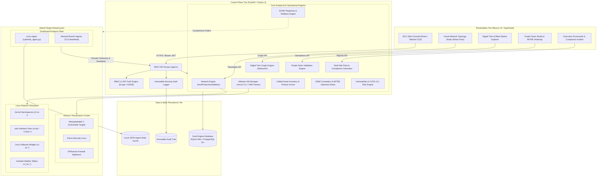

# CyberLab

> **Enterprise Hybrid Cybersecurity Infrastructure, Network Simulation Engine, Distributed Endpoint Security (EDR), SIEM Correlation, SOAR Incident Response, Digital Twin, Purple-Team Studio, and Compliance Platform**

[](https://www.kernel.org)
[](#)
[](https://fastapi.tiangolo.com)
[](https://nextjs.org)
[](https://www.typescriptlang.org)
[](https://www.python.org)
[](https://www.postgresql.org)
[](#testing--verification)
[](#)

---

## 1. Executive Overview

**CyberLab** is a unified, modular, and security-hardened hybrid cybersecurity operations platform. It bridges the gap between simulated software networks, real hypervisor virtual machines, distributed host endpoints, and enterprise Security Operations Centers (SOCs).

Traditionally, organizations deploy fragmented tools for lab virtualization, endpoint monitoring, security incident event management (SIEM), orchestration (SOAR), and attack validation. CyberLab unifies these capabilities into an integrated control plane with a centralized web interface and RESTful API:

- **Linux Kernel Network Simulation**: Kernel network namespaces (`ip netns`), virtual Ethernet (`veth`) pairs, Linux software bridges, and `nftables` packet filtering with non-destructive host protection validators.
- **Real Hypervisor Virtual Machine Integration**: VMware Workstation CLI (`vmrun`) adapter managing real guest VMs (Metasploitable 2, Parrot Security, OPNsense, etc.) with automatic adapter inspection and bridged network exposure warnings.
- **Distributed Linux Endpoint Security (EDR)**: Lightweight standalone Python agent (`cyberlab_agent.py`) collecting live process trees, listening sockets, SHA-256 File Integrity Monitoring (FIM) baselines, and network quarantine directives.
- **Unified Asset Inventory & Risk Scoring**: Automatic entity deduplication across physical, virtual, and simulated tiers with dynamic asset risk scoring (0–100).
- **SIEM & Real-Time Detection Correlation**: Normalized security event ingestion mapped to MITRE ATT&CK tactics, stateful sliding-window detection rules, alert deduplication, and automated root-cause analysis (RCA).
- **Incident Response & SOAR Engine**: Automated containment playbooks (`ISOLATE_HOST`, `BLOCK_IP`, `SUSPEND_VM`, `REVOKE_CREDENTIALS`), human-in-the-loop (HITL) authorization gates, and verified 1-click state rollback.
- **Digital Twin & Attack-Path Graph Engine**: NetworkX directed multigraph calculating multi-hop reachability, blast-radius analysis, and defensive choke points.
- **Purple-Team Studio & Continuous Validation**: Safe, atomic adversary emulation scenarios measuring defensive detection efficacy (%), Mean Time to Detect (MTTD), and MITRE coverage gap heatmaps.
- **Vulnerability Management & CVSS v3.1 Engine**: Canonical CVE catalog matching, dynamic asset risk adjustments based on CVSS scoring, and complete remediation lifecycle tracking.
- **Multi-Site Enterprise Fleet & Governance**: Remote site isolation, fleet aggregation, board-ready executive scorecards, continuous NIST CSF 2.0 / CIS Controls compliance auditing, and PostgreSQL production readiness.

---

## 2. Platform Architecture

The platform is designed in a decoupled three-tier architecture: the Next.js 14 SOC Web Dashboard, the FastAPI Asynchronous Control Plane, and the Hybrid Target Infrastructure.



---

## 3. Threat Detection & SOAR Response Lifecycle

CyberLab provides a closed-loop security workflow where agent telemetry, network events, and adversary emulations are ingested, correlated against MITRE ATT&CK rules, escalated to incidents, and contained via approval-gated playbooks with verified rollback:

```mermaid
sequenceDiagram
    autonumber
    participant Target as Endpoint / Real VM
    participant Agent as CyberLab Agent
    participant SIEM as SIEM Engine
    participant SOAR as SOAR Engine
    participant SOC as SOC Operator / Admin

    Note over Target,Agent: Suspicious Activity Occurs
    Target->>Agent: Shell spawned / sensitive file modified (/etc/shadow)
    Agent->>Agent: Detects FIM SHA-256 baseline delta
    Agent->>SIEM: POST /api/v1/agents/telemetry (FIM Alert + Sockets)

    Note over SIEM: Real-Time Event Normalization
    SIEM->>SIEM: Evaluates Stateful Detection Rules
    Note right of SIEM: RULE_CREDENTIAL_DUMPING_SHADOW triggered<br/>Mapped to MITRE T1003.008 (Severity: CRITICAL)
    SIEM->>SIEM: Generates SecurityAlert & Correlates SecurityIncident
    SIEM->>SOAR: Triggers Autonomous Containment Playbook

    Note over SOAR: Human-in-the-Loop Approval Gate
    SOAR->>SOAR: Creates Action (Status: PENDING_APPROVAL)
    SOAR->>SOC: Alerts SOC Console (Incident Quarantine Requested)
    SOC->>SOAR: POST /api/v1/soar/actions/{id}/approve

    Note over SOAR: Containment Execution
    SOAR->>SOAR: Executes Action (Status: EXECUTING)
    SOAR->>Agent: Dispatches "ISOLATE" command in heartbeat response
    Agent->>Target: Locks down network traffic policy
    SOAR->>SOAR: Post-Execution Verification (verified = True)
    SOAR->>SOC: Incident Status: CONTAINED (Status: COMPLETED)

    Note over SOC,SOAR: Post-Incident Forensic Rollback
    SOC->>SOAR: POST /api/v1/soar/actions/{id}/rollback
    SOAR->>Agent: Dispatches "RESTORE" command
    Agent->>Target: Restores normal network traffic policy
    SOAR->>SOC: Action Rolled Back; Status: RESTORED
```

---

## 4. Platform Modules & Execution Matrix

All 12 architectural phases have been implemented and verified:

| Module | Title | Primary Components & APIs | Key Capabilities |
|:---:|---|---|---|
| **Phase 1** | **Core Foundation & RBAC** | `app/api/v1/auth.py`<br>`app/api/v1/users.py`<br>`app/api/v1/audit.py` | JWT authentication, bcrypt hashing, multi-tenant RBAC (`SUPER_ADMIN`, `SOC_ANALYST`, `NETWORK_ENGINEER`, `AUDITOR`), immutable audit trail. |
| **Phase 2** | **Linux Network Engine** | `app/network/manager.py`<br>`app/network/safety.py`<br>`app/network/linux_driver.py` | Host protection validator (`HostProtectionValidator`), network namespaces, veth pairs, Linux software bridges, and React Flow visual studio. |
| **Phase 3** | **Real VM Integration** | `app/vm/manager.py`<br>`app/vm/vmware_adapter.py`<br>`app/vm/vmx_parser.py` | VMware Workstation CLI (`vmrun`) adapter, power cycling (start/stop/reset/suspend), VMX configuration parser, vulnerable VM detection. |
| **Phase 4** | **Distributed Linux Agent** | `agent/cyberlab_agent.py`<br>`app/api/v1/agents.py` | Standalone Python EDR daemon, TLS heartbeat, hardware inventory, process snapshotting, socket tracking, SHA-256 FIM, and quarantine. |
| **Phase 5** | **Asset Inventory & Risk** | `app/inventory/asset_manager.py`<br>`app/api/v1/assets.py` | Multi-source asset reconciliation, entity deduplication, asset-to-segment topology binding, dynamic asset risk scoring (0–100). |
| **Phase 6** | **SIEM & Correlation Engine** | `app/siem/engine.py`<br>`app/siem/rules.py`<br>`app/api/v1/siem.py` | Event normalization, MITRE ATT&CK taxonomy, 5 stateful detection rules (Brute-Force, Sudo abuse, Shadow dump, SYN scan, Reverse shells). |
| **Phase 7** | **Incident Response (SOAR)** | `app/soar/engine.py`<br>`app/api/v1/soar.py` | Playbook catalog, human-in-the-loop authorization gates, execution verification, reversible containment, and 1-click state rollback. |
| **Phase 8** | **Digital Twin & Attack Paths** | `app/digital_twin/graph_engine.py`<br>`app/api/v1/digital_twin.py` | NetworkX topological directed graph, multi-hop reachability, blast radius calculation, perimeter traversal, and defensive choke points. |
| **Phase 9–10** | **Purple-Team Studio** | `app/purple_team/engine.py`<br>`app/api/v1/purple_team.py` | Safe atomic adversary emulation, closed-loop SIEM detection validation, defensive efficacy scoring (%), MTTD, MITRE gap heatmap. |
| **Phase 11** | **Vulnerability Management** | `app/vulnerability/engine.py`<br>`app/api/v1/vulnerability.py` | Canonical CVE catalog, service-to-CVE matching, CVSS v3.1 dynamic asset risk recalibration, remediation status tracking. |
| **Phase 12** | **Multi-Site & Governance** | `app/enterprise/site_service.py`<br>`app/enterprise/report_generator.py` | Remote site isolation, live fleet KPI aggregation, executive scorecards, continuous NIST CSF 2.0 / CIS Controls compliance auditing. |

---

## 5. Technology Stack

### Frontend Application
- **Framework**: [Next.js 14](https://nextjs.org) (React 18, App Router)
- **Language**: [TypeScript](https://www.typescriptlang.org) (Strict mode enabled)
- **Styling**: [Tailwind CSS](https://tailwindcss.com) (Custom dark cyber-theme)
- **Icons**: [Lucide React](https://lucide.dev)
- **Interactive Graph Canvas**: [@xyflow/react](https://reactflow.dev) (React Flow)

### Backend Control Plane
- **Framework**: [FastAPI](https://fastapi.tiangolo.com) (Python 3.10+)
- **Data Validation & Settings**: [Pydantic v2](https://docs.pydantic.dev) & `pydantic-settings`
- **ORM & Database Layer**: [SQLAlchemy 2.0](https://www.sqlalchemy.org)
- **Graph & Topology Engine**: [NetworkX](https://networkx.org)
- **Authentication & Cryptography**: `pyjwt` (HS256), `bcrypt` (12 rounds)
- **Database Support**: Dual-mode engine — SQLite with Write-Ahead Logging (WAL) for development; PostgreSQL 15+ connection pooling for production.

### Linux Infrastructure & Hypervisor
- **Network Virtualization**: Linux Kernel Namespaces (`ip netns`), `veth` pairs, `bridge` interfaces, `nftables`
- **Virtualization Integration**: VMware Workstation CLI (`/usr/bin/vmrun`), `.vmx` key-value parser
- **Endpoint Agent**: Autonomous Python daemon (`urllib`, `hashlib`, `psutil`)

---

## 6. Repository Layout

```
CyberLab/
├── agent/                                # Distributed Linux Endpoint Agent
│   └── cyberlab_agent.py                 # Standalone EDR Agent (FIM, Telemetry, Quarantine)
├── backend/                              # FastAPI Python Backend
│   ├── app/
│   │   ├── api/v1/                       # REST API Routers
│   │   │   ├── agents.py                 # Endpoint Fleet & Agent Handlers
│   │   │   ├── assets.py                 # Asset Inventory & Risk Endpoints
│   │   │   ├── audit.py                  # Immutable Audit Trail API
│   │   │   ├── auth.py                   # JWT Login, Logout, Profile
│   │   │   ├── digital_twin.py           # Graph Reachability & Blast Radius
│   │   │   ├── health.py                 # System Health & Hardware Metrics
│   │   │   ├── purple_team.py            # Simulation Scenarios & Campaigns
│   │   │   ├── reports.py                # Executive Scorecards & Compliance
│   │   │   ├── siem.py                   # Events, Alerts, Incidents, MITRE
│   │   │   ├── sites.py                  # Multi-Site Fleet Management
│   │   │   ├── soar.py                   # Playbooks, Approvals, Rollback
│   │   │   ├── topologies.py             # Network Simulation Topologies
│   │   │   ├── users.py                  # RBAC User Management
│   │   │   ├── vms.py                    # VMware Workstation VM Control
│   │   │   └── vulnerability.py          # CVE Catalog & Remediation
│   │   ├── core/                         # Core Settings, Security, Dependencies
│   │   ├── database/                     # SQLAlchemy Session & Seeding
│   │   ├── digital_twin/                 # NetworkX Graph Topology Engine
│   │   ├── enterprise/                   # Site Management & Report Generator
│   │   ├── inventory/                    # Asset Reconciliation & Risk Engine
│   │   ├── middleware/                   # Security Headers, Access Logging
│   │   ├── models/                       # SQLAlchemy 2.0 Database Models
│   │   ├── network/                      # Linux Netns & HostProtectionValidator
│   │   ├── purple_team/                  # Purple-Team Validation Engine
│   │   ├── schemas/                      # Pydantic v2 Request/Response Schemas
│   │   ├── siem/                         # SIEM Ingestion & MITRE ATT&CK Rules
│   │   ├── soar/                         # SOAR Playbook Execution Engine
│   │   ├── vm/                           # VMware Workstation CLI Adapter
│   │   └── vulnerability/                # CVE Matching & CVSS v3.1 Engine
│   ├── tests/                            # Automated Pytest Suite (71 Tests)
│   └── requirements.txt                  # Python Backend Dependencies
├── frontend/                             # Next.js 14 TypeScript Frontend
│   ├── src/
│   │   ├── app/                          # App Router (page.tsx, layout.tsx)
│   │   ├── components/                   # Subsystem UI Modules
│   │   │   ├── agent/                    # Endpoint Fleet Workspace
│   │   │   ├── dashboard/                # SOC Overview & Metric Cards
│   │   │   ├── digital_twin/             # Blast Radius & Choke Point Views
│   │   │   ├── enterprise/               # Multi-Site & Compliance Center
│   │   │   ├── inventory/                # Unified Asset Inventory Table
│   │   │   ├── layout/                   # Sidebar & Topbar Headers
│   │   │   ├── network/                  # Network Simulation Studio
│   │   │   ├── purple_team/              # Purple-Team Simulation Console
│   │   │   ├── siem/                     # SIEM Incident & MITRE Board
│   │   │   ├── soar/                     # Playbook Approval & Rollback
│   │   │   ├── vm/                       # Virtual Machine Control Center
│   │   │   └── vulnerability/            # CVE Catalog & Remediation
│   │   └── lib/                          # API Client & TypeScript Interfaces
│   ├── package.json                      # Node.js Dependencies
│   └── tailwind.config.ts                # Tailwind CSS Configuration
├── documentation/                        # Comprehensive Technical Specifications
│   ├── PRODUCTION_READINESS_AUDIT.md     # Independent v1.0.0 Readiness Audit
│   ├── SECURITY_AUDIT.md                 # White-Box Threat Model & Findings
│   ├── INTEGRATION_TEST_RESULTS.md       # Full 71-Test Execution Log
│   ├── NETWORK_ISOLATION_TESTS.md        # Netns & Host Protection Verification
│   ├── AGENT_SECURITY_AUDIT.md           # Agent Lifecycle & Security Review
│   ├── SOAR_SAFETY_AUDIT.md              # Containment Engine & Rollback Safety
│   ├── POSTGRESQL_READINESS.md           # Dual-Engine Database Migration Guide
│   ├── PRODUCTION_DEPLOYMENT_CHECKLIST.md# Enterprise Hardening Checklist
│   ├── KNOWN_LIMITATIONS.md              # Catalog of Platform Boundaries
│   ├── MULTI_SITE_ENTERPRISE.md          # Multi-Site Architecture & APIs
│   ├── VULNERABILITY_MANAGEMENT.md       # CVSS Risk Engine Specification
│   ├── PURPLE_TEAM.md                    # Attack Emulation & MITRE Heatmaps
│   ├── DIGITAL_TWIN.md                   # NetworkX Graph Engine Documentation
│   ├── SOAR_ENGINE.md                    # Playbooks & Approval Gate Design
│   ├── SIEM_ARCHITECTURE.md              # Telemetry & Detection Rules
│   ├── ASSET_INVENTORY.md                # Reconciliation & Risk Scoring
│   ├── AGENT_ARCHITECTURE.md             # EDR Architecture & Protocol
│   ├── VM_INTEGRATION.md                 # VMware Adapter & VMX Specification
│   ├── NETWORK_ENGINE.md                 # Linux Network Engine Documentation
│   └── CHANGELOG.md                      # Complete Project Changelog
└── README.md                             # Project Documentation
```

---

## 7. Quickstart Guide

### 7.1 Prerequisites
- **Operating System**: Linux (Kali Linux, Ubuntu 22.04+, Debian 12, or RHEL 9 recommended)
- **Python**: Version 3.10, 3.11, 3.12, 3.13, or 3.14
- **Node.js**: Version 18.x or 20.x LTS with npm
- **Hypervisor (Optional)**: VMware Workstation Pro / Player with `/usr/bin/vmrun` installed
- **Privileges**: Normal unprivileged user for web server execution; root/sudo only required if running kernel-level network driver or endpoint isolation.

---

### 7.2 Backend Installation

1. Navigate to the backend directory and establish a virtual environment:
   ```bash
   cd /home/ghost/Desktop/CyberLab/backend
   python3 -m venv venv
   source venv/bin/activate
   ```

2. Install backend dependencies:
   ```bash
   pip install -r requirements.txt
   pip install networkx>=3.4.2 psycopg2-binary>=2.9.9 alembic>=1.13.0
   ```

3. Configure environment variables (Optional, defaults to local SQLite WAL):
   ```bash
   # Create .env file
   cat << 'EOF' > .env
   PROJECT_NAME=CyberLab
   ENVIRONMENT=development
   SECRET_KEY=cyberlab_production_secret_key_change_in_production_2026!
   DATABASE_URL=sqlite:///./cyberlab.db
   EOF
   ```

4. Run the automated Pytest test suite:
   ```bash
   PYTHONPATH=. pytest -v
   ```

5. Start the FastAPI backend server:
   ```bash
   uvicorn app.main:app --host 127.0.0.1 --port 8000 --reload
   ```
   *The interactive OpenAPI Swagger documentation will be available at [http://127.0.0.1:8000/docs](http://127.0.0.1:8000/docs).*

---

### 7.3 Frontend Installation

1. Navigate to the frontend directory:
   ```bash
   cd /home/ghost/Desktop/CyberLab/frontend
   ```

2. Install Node.js dependencies:
   ```bash
   npm install
   ```

3. Build for production or start development server:
   ```bash
   # Development Server
   npm run dev

   # Production Build Verification
   npm run build
   npm run start
   ```

4. Open your web browser at [http://localhost:3000](http://localhost:3000) to access the CyberLab SOC Dashboard.

---

### 7.4 Running the Distributed Linux Agent

To deploy an endpoint security agent on a monitored Linux workstation:

```bash
cd /home/ghost/Desktop/CyberLab/agent

# Run continuous background monitoring daemon
python3 cyberlab_agent.py --server http://127.0.0.1:8000 --interval 10

# Or execute a single registration and telemetry check-in
python3 cyberlab_agent.py --server http://127.0.0.1:8000 --run-once
```

---

## 8. Default Administrative Credentials

The database automatically seeds default baseline accounts during initial startup:

| Username | Email | Default Password | Role | Access Scope |
|---|---|---|---|---|
| `admin` | `admin@cyberlab.local` | `CyberLab@Admin2026!` | `SUPER_ADMIN` | Unrestricted full platform control |
| `analyst` | `analyst@cyberlab.local` | `Analyst@CyberLab2026!` | `SOC_ANALYST` | SIEM, SOAR, Alerts, Incidents |
| `engineer`| `engineer@cyberlab.local`| `Engineer@CyberLab2026!`| `NETWORK_ENGINEER`| Network Simulation & Topologies |
| `auditor` | `auditor@cyberlab.local` | `Auditor@CyberLab2026!` | `AUDITOR` | Read-only Audit Trail & Compliance |

> [!WARNING]
> **Production Credential Advisory**: These seeded accounts are intended for lab demonstration. When deploying in production, immediately rotate passwords for all seeded accounts. Consult the [Production Deployment Checklist](file:///home/ghost/Desktop/CyberLab/documentation/PRODUCTION_DEPLOYMENT_CHECKLIST.md) for step-by-step instructions.

---

## 9. Testing & Verification

CyberLab includes a comprehensive test suite covering all 12 platform tiers:

```bash
cd /home/ghost/Desktop/CyberLab/backend
PYTHONPATH=. pytest -q
```

### Test Breakdown
- `test_health.py`: System health and platform hardware metrics (CPU/RAM/Disk).
- `test_auth.py`: JWT login, token expiry, and subject claim validation.
- `test_rbac.py`: Multi-tier role permissions and access denial enforcement.
- `test_audit.py`: Immutable security audit log generation and filtering.
- `test_network_engine.py`: `HostProtectionValidator` boundaries and topology lifecycle.
- `test_vm_integration.py`: VMX configuration parser and `vmrun` power actions.
- `test_agent.py` & `test_agent_e2e.py`: Agent registration, heartbeats, and FIM baselining.
- `test_asset_inventory.py`: Cross-tier entity reconciliation and dynamic risk scoring.
- `test_siem.py`: Stateful MITRE ATT&CK detection rules and incident correlation.
- `test_soar.py`: Containment playbooks, approval gates, and rollback validation.
- `test_digital_twin.py`: NetworkX graph reachability, blast radius, and choke points.
- `test_purple_team.py`: Atomic simulations, closed-loop SIEM validation, and MTTD.
- `test_vulnerability.py`: Canonical CVE matching, CVSS v3.1 scoring, and remediation.
- `test_multi_site_reports.py`: Multi-site fleet aggregation and compliance auditing.

---

## 10. Audit & Production Readiness Reports

Following the completion of Phase 12, an independent white-box security audit was conducted. The complete audit reports are available in the repository:

- [PRODUCTION_READINESS_AUDIT.md](file:///home/ghost/Desktop/CyberLab/documentation/PRODUCTION_READINESS_AUDIT.md) — Comprehensive phase-by-phase evaluation and release verdict.
- [SECURITY_AUDIT.md](file:///home/ghost/Desktop/CyberLab/documentation/SECURITY_AUDIT.md) — Detailed threat modeling, secret analysis, and classified findings (SEC-01 to SEC-10).
- [SOAR_SAFETY_AUDIT.md](file:///home/ghost/Desktop/CyberLab/documentation/SOAR_SAFETY_AUDIT.md) — Containment playbook safety review and rollback verification.
- [AGENT_SECURITY_AUDIT.md](file:///home/ghost/Desktop/CyberLab/documentation/AGENT_SECURITY_AUDIT.md) — Endpoint agent lifecycle and communication security review.
- [NETWORK_ISOLATION_TESTS.md](file:///home/ghost/Desktop/CyberLab/documentation/NETWORK_ISOLATION_TESTS.md) — Kernel boundary enforcement and host interface protection guarantees.
- [POSTGRESQL_READINESS.md](file:///home/ghost/Desktop/CyberLab/documentation/POSTGRESQL_READINESS.md) — Dual-database architecture and PostgreSQL 15+ migration guide.
- [PRODUCTION_DEPLOYMENT_CHECKLIST.md](file:///home/ghost/Desktop/CyberLab/documentation/PRODUCTION_DEPLOYMENT_CHECKLIST.md) — Enterprise deployment hardening checklist.
- [KNOWN_LIMITATIONS.md](file:///home/ghost/Desktop/CyberLab/documentation/KNOWN_LIMITATIONS.md) — Complete catalog of platform boundaries, fallbacks, and simulation trade-offs.

---

## 11. License & Security Notice

CyberLab is developed for educational, defense-in-depth security training, authorized security audits, and laboratory research.

- **Non-Destructive Host Guarantee**: CyberLab's `HostProtectionValidator` is configured to prevent operations from mutating physical host network interfaces (`wlan0`, `eth0`), default gateways, or root firewall tables.
- **Vulnerable Machine Containment**: Virtual machines identified as vulnerable targets (e.g. Metasploitable) must always be bound to **Host-Only (`vmnet1`)** or isolated simulated bridges, and **never exposed to physical bridged networks (`vmnet0`)**.
